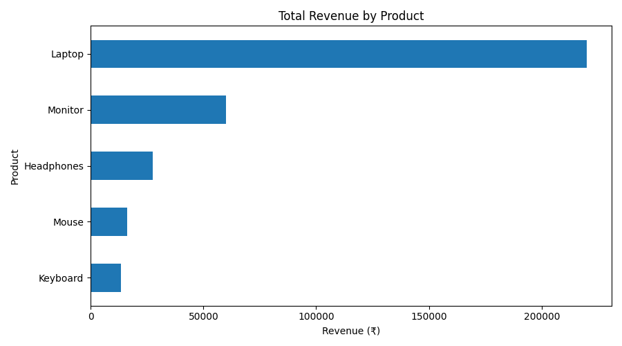
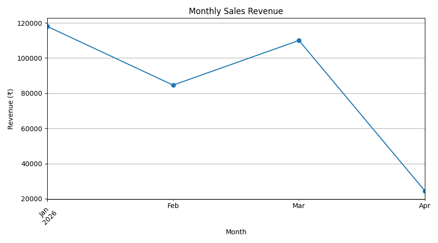

# 📊 Sales Data Analyzer Using Python

## 📌 Project Overview

The **Sales Data Analyzer** is a Python-based data analytics project that analyzes sales transaction data to identify revenue trends, product performance, and useful business insights. It demonstrates essential data analyst skills, including data cleaning, data transformation, exploratory data analysis, and data visualization.

## 🎯 Project Objectives

- Clean and prepare raw sales data for analysis.
- Calculate key sales performance metrics.
- Identify top-performing products.
- Analyze monthly revenue trends.
- Generate visualizations to communicate insights.
- Export cleaned data for further analysis.

## 🛠️ Technologies Used

- **Python** – Data analysis and processing
- **Pandas** – Data cleaning, transformation, and aggregation
- **Matplotlib** – Data visualization

## ✨ Key Features

### 1. Data Inspection
- View dataset dimensions and column information.
- Check for missing values and duplicate records.
- Understand the structure of the sales dataset.

### 2. Data Cleaning
- Remove duplicate records.
- Convert dates into a suitable datetime format.
- Convert quantity and unit price columns into numeric values.
- Handle invalid or missing records.
- Filter invalid quantities and prices.

### 3. Sales Performance Analysis
Calculate and analyze:
- Total revenue
- Number of unique orders
- Total units sold
- Average order value

### 4. Product and Monthly Analysis
- Calculate revenue by product.
- Analyze units sold by product.
- Identify monthly revenue trends.
- Analyze revenue by category when the dataset contains a category column.

### 5. Data Visualization
Generate charts to help understand sales performance:
- `revenue_by_product.png`
- `monthly_sales.png`

### 6. Export Cleaned Data
Save the processed dataset as `cleaned_sales_data.csv` for future analysis or reporting.

## 📊 Output Visualizations

### 1. Total Revenue by Product

This horizontal bar chart compares total revenue generated by each product. It helps identify the products contributing the most revenue.



### 2. Monthly Sales Revenue

This line chart shows monthly revenue trends from January to April 2026, helping visualize changes in sales performance over time.



### 🔍 Key Observations

- **Laptop** generates the highest revenue among the products shown.
- **Monitor** is the second-highest revenue-generating product.
- Monthly revenue decreases from January to February, increases in March, and drops significantly in April.
- These visualizations help identify product performance and monthly revenue trends.


## 📂 Project Structure

```text
Sales-Data-Analyzer/
│
├── sales_analyzer.py
├── sales_data.csv
├── README.md
│
├── revenue_by_product.png       # Generated after running the script
├── monthly_sales.png            # Generated after running the script
└── cleaned_sales_data.csv       # Generated after running the script
```

## 🚀 How to Run the Project

### Step 1: Install Python

Download Python from [python.org](https://www.python.org/downloads/) if it is not already installed.

### Step 2: Install Required Libraries

Open the terminal in VS Code and run:

```bash
python -m pip install pandas matplotlib
```

### Step 3: Run the Python Script

Make sure the terminal is in the project folder and run:

```bash
python sales_analyzer.py
```

### Step 4: View the Results

After successful execution, check the terminal output and project folder for the generated charts and cleaned CSV file.

## 📈 Expected Outputs

| Output | Description |
|---|---|
| Sales metrics | Revenue, order count, units sold, and average order value |
| Product analysis | Revenue and units sold by product |
| Monthly analysis | Revenue trends over time |
| `revenue_by_product.png` | Product revenue visualization |
| `monthly_sales.png` | Monthly sales visualization |
| `cleaned_sales_data.csv` | Cleaned sales dataset |

*Actual results depend on the input dataset and successful execution of the script.*

## 📚 Key Learning Outcomes

Through this project, I practiced:

- Data cleaning and preprocessing using Pandas
- Handling missing values and duplicate records
- Working with dates and numeric data types
- Grouping and aggregating sales data
- Calculating business performance metrics
- Creating charts using Matplotlib
- Exporting cleaned datasets for further analysis

## 🔮 Future Improvements

- Build an interactive sales dashboard using Power BI.
- Add sales KPIs and additional business insights.
- Introduce filters for product, category, and date.
- Develop an interactive dashboard using Streamlit.

## 🔗 GitHub Repository

[View Sales Data Analyzer on GitHub](https://github.com/DhanalakshmiJayakumar/Sales-Data-Analyzer)

